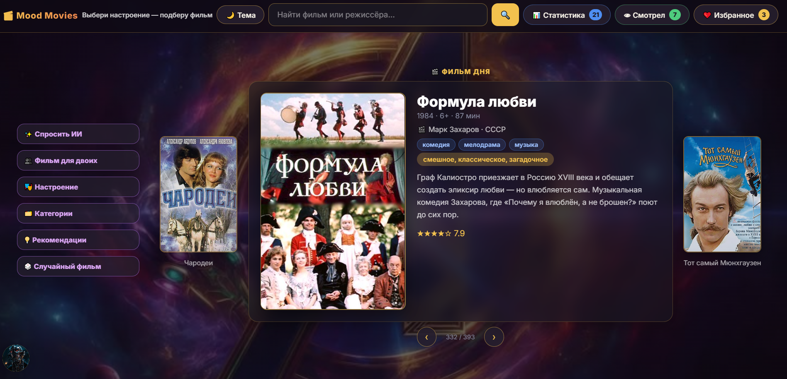
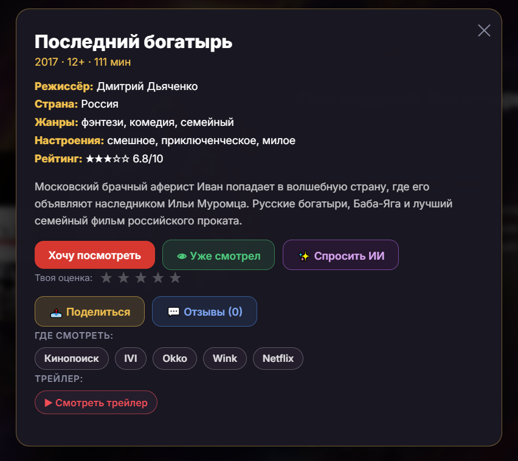
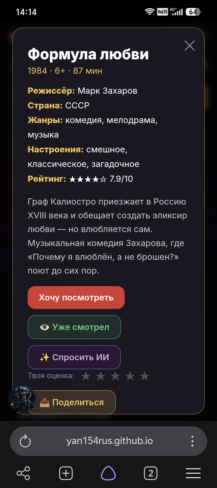

# Mood Movies — фильмы под настроение

**[Открыть сайт](https://yan154rus.github.io/mood-movies/)**

Mood Movies — веб-сервис, который подбирает фильмы под ваше настроение: 393 фильма, умные фильтры, ИИ-помощник и личная статистика просмотров.

## Что умеет

- **Подбор по настроению** — 8 категорий: от «вдохновляющего» до «успокаивающего»;
- **Фильм дня** — ежедневная рекомендация с каруселью соседних вариантов;
- **ИИ-помощник** — чат, который рекомендует фильмы и отвечает на вопросы о кино;
- **Фильм для двоих** — подбор, учитывающий вкусы двух зрителей;
- **Категории и фильтры** — жанры, годы, рейтинги, возрастные ограничения;
- **Избранное, «Смотрел» и оценки** — с сохранением в браузере;
- **Отзывы** — личные заметки к каждому фильму;
- **Статистика** — сколько посмотрели, что добавили, распределение по жанрам;
- **Тёмная и светлая темы**.

## Как создавался проект

Проект сделан в соавторстве с AI-ассистентом (Алиса AI): код писался с помощью ИИ по поставленным задачам, а автор проекта выполнял роль продюсера — придумывал функционал, формулировал задачи, тестировал результат на реальных устройствах, находил дефекты и принимал решения о внешнем виде и поведении сайта, а также публиковал проект на GitHub Pages.

## Технологии

- **HTML5, CSS3, JavaScript** — без фреймворков и сборки, чистая статика;
- **The Movie Database (TMDB)** — данные о фильмах, постеры, «где смотреть»;
- **Pollinations AI** — чат-помощник;
- **Wikipedia API** — факты о фильмах;
- **localStorage** — хранение пользовательских данных без сервера;
- **GitHub Pages** — хостинг.

## Запуск локально

1. Склонируйте репозиторий: `git clone https://github.com/yan154rus/mood-movies.git`
2. Откройте `index.html` в браузере — сборка не нужна.

## Скриншоты

| Десктоп | Мобильный |
|---|---|
|  |  |
|  |  |
|  | — |

## Планы

- Аккаунты и синхронизация списков между устройствами (Supabase);
- Прокси-бэкенд (Cloudflare Worker) для скрытия API-ключей;
- Собственный TMDB-ключ для сайта — независимость «где смотреть» от чужих ключей;
- Рекомендации «похожие на просмотренное» на основе истории просмотров;
- Своя страница фильма с полной информацией;
- Расширенная статистика: жанры, месяцы, любимые режиссёры;
- Публичные страницы: политика конфиденциальности и оферта;
- Платежи и подписка (после появления аккаунтов).
